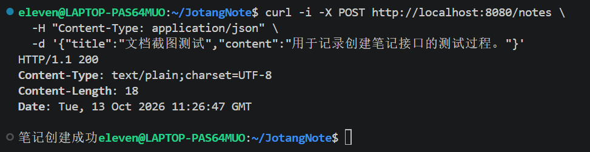
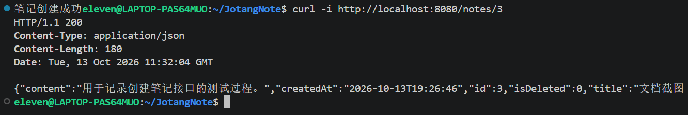
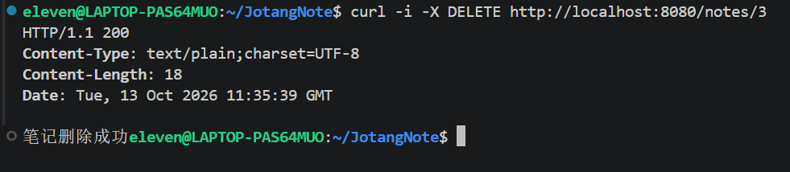
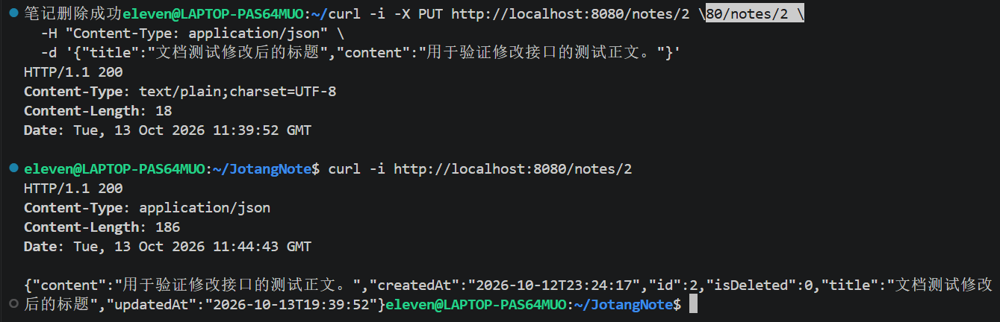

# JotangNote 任务01：笔记管理接口说明文档

## 1. 功能概述

本功能基于 Spring Boot、MyBatis 和 MySQL 实现笔记管理，包含以下四个接口：

| 功能 | HTTP 方法 | 请求路径 |
|---|---|---|
| 创建笔记 | POST | `/notes` |
| 查询笔记 | GET | `/notes/{id}` |
| 删除笔记 | DELETE | `/notes/{id}` |
| 修改笔记 | PUT | `/notes/{id}` |

笔记数据存储在 MySQL 数据库 `jotangnote` 的 `notes` 表中。

## 2. 项目结构与分层设计

本功能采用分层结构：

- **Entity：** 定义笔记的数据结构。
- **Mapper：** 使用 MyBatis 执行 SQL，访问 MySQL 数据库。
- **Service：** 负责组织笔记相关的业务操作。
- **Controller：** 接收 HTTP 请求，调用 Service，并返回响应。

一次典型的请求处理流程为：

客户端 → Controller → Service → Mapper → MySQL

数据库操作完成后，结果沿调用链返回给客户端。

## 3. 数据表设计

数据表名称：`notes`

| 字段 | 类型 | 作用 |
|---|---|---|
| `id` | BIGINT | 笔记唯一标识，自动递增 |
| `title` | VARCHAR(255) | 笔记标题 |
| `content` | TEXT | 笔记正文 |
| `created_at` | DATETIME | 笔记创建时间 |
| `updated_at` | DATETIME | 笔记最后修改时间 |
| `is_deleted` | TINYINT(1) | 逻辑删除标识，0 表示正常，1 表示已删除 |

## 4. 接口一：创建笔记

### 4.1 使用流程

客户端向 `POST /notes` 发送包含标题和正文的 JSON 数据。Controller 将请求正文转换为 Note 对象，Service 调用 Mapper，Mapper 执行 INSERT 语句，将笔记保存到数据库。

### 4.2 核心逻辑

Mapper 使用 `@Insert` 注解执行插入操作。SQL 中的 `#{title}` 和 `#{content}` 分别获取 Note 对象的对应属性。

Service 将 Mapper 返回的受影响记录数交给 Controller。Controller 根据结果返回创建成功或失败的信息。

### 4.3 测试过程与结果

- 请求方法：POST
- 请求路径：`/notes`
- 请求正文：

```json
{
  "title": "测试笔记",
  "content": "这是测试笔记的正文。"
}
```

- 预期结果：笔记创建成功，数据库生成笔记 ID。
- 实际结果：待补充实际测试记录。

### 4.4 测试截图



## 5. 接口二：查询笔记

### 5.1 使用流程

客户端向 `GET /notes/{id}` 发送请求。Controller 获取路径中的笔记 ID，Service 调用 Mapper，Mapper 使用 SELECT 语句查询未被逻辑删除的笔记。

### 5.2 核心逻辑

Controller 使用 `@GetMapping("/{id}")` 映射查询接口，并使用 `@PathVariable` 获取路径参数。

Mapper 使用 `@Select` 查询数据库，并通过 `AS` 为数据库字段指定与 Java 属性对应的名称，例如 `created_at AS createdAt`。

### 5.3 测试过程与结果

- 请求方法：GET
- 请求路径示例：`/notes/2`
- 预期结果：返回对应笔记的 JSON 数据。
- 实际结果：已验证查询接口能够正常返回笔记数据，具体响应截图待补充。

### 5.4 测试截图



## 6. 接口三：删除笔记

### 6.1 使用流程

客户端向 `DELETE /notes/{id}` 发送请求。Controller 获取笔记 ID，Service 调用 Mapper，Mapper 将对应记录的 `is_deleted` 修改为 1。

### 6.2 核心逻辑

该接口采用逻辑删除，而不是真正删除数据库记录。

Mapper 使用 `@Update` 执行 UPDATE 语句。SQL 同时检查笔记 ID 和 `is_deleted = 0`，避免重复删除已经删除的笔记。

### 6.3 测试过程与结果

- 请求方法：DELETE
- 请求路径：待补充实际测试使用的笔记 ID。
- 预期结果：删除成功，笔记不再被正常查询接口返回。
- 实际结果：已进行删除接口测试，具体请求、响应和数据库验证截图待补充。

### 6.4 测试截图



## 7. 接口四：修改笔记

### 7.1 使用流程

客户端向 `PUT /notes/{id}` 发送请求，并在 JSON 正文中提供修改后的标题和正文。Controller 获取路径中的 ID，将其设置到 Note 对象中，再调用 Service 完成更新操作。

### 7.2 核心逻辑

Controller 使用 `@PutMapping("/{id}")` 映射修改接口，并通过 `@RequestBody` 接收 JSON 数据。

调用 Service 前，使用 `note.setId(id)` 将路径中的 ID 设置到 Note 对象中，确保更新操作针对请求指定的笔记。

Mapper 使用 UPDATE 语句修改标题和正文，并检查笔记尚未被逻辑删除。

### 7.3 测试过程与结果

- 请求方法：PUT
- 请求路径：`/notes/2`
- 请求正文：

```json
{
  "title": "修改后的标题",
  "content": "这是修改后的内容。"
}
```

- 预期结果：返回修改成功信息；再次查询时，标题和正文均为修改后的内容。
- 实际结果：已验证修改后的标题和正文能够正确查询出来。

### 7.4 测试截图



## 8. 总结

本功能完成了笔记的创建、查询、删除和修改，初步实现了基于 Spring Boot、MyBatis 和 MySQL 的数据操作流程。

通过本次实践，进一步理解了 Controller、Service、Mapper 和 Entity 的分工，以及 HTTP 请求、Java 对象、SQL 操作和 JSON 响应之间的关系。

后续可以继续完善参数校验、异常处理、统一响应格式和自动化测试等功能。
