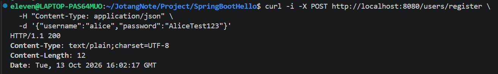
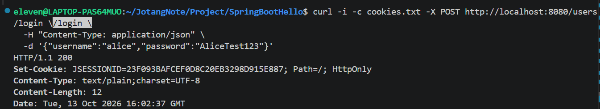
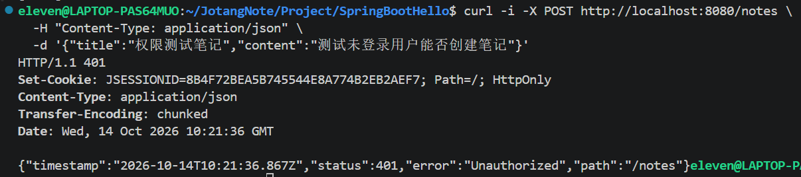
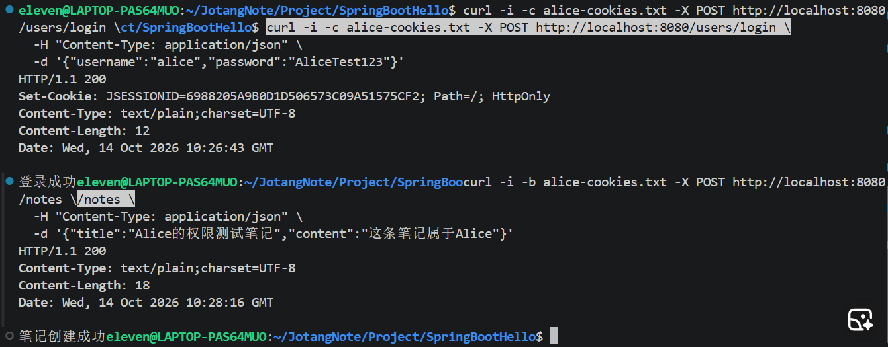
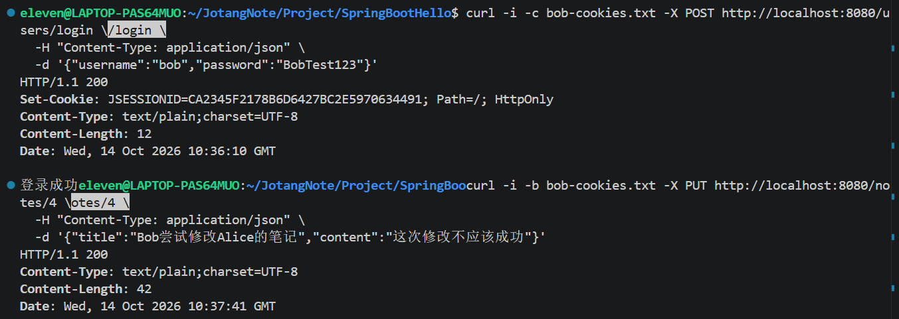
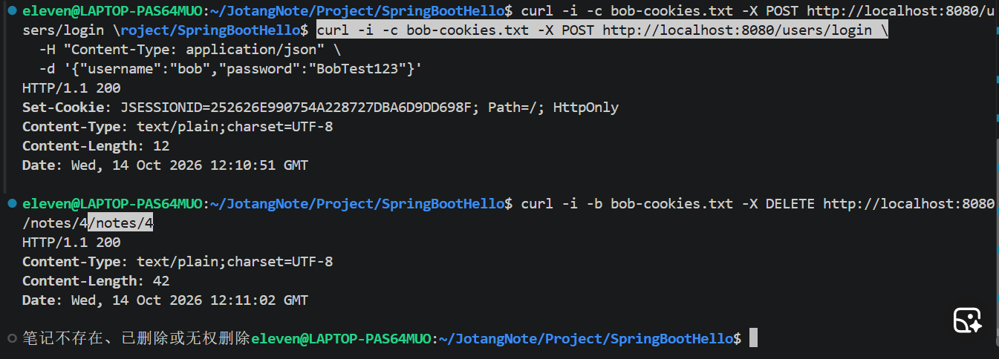
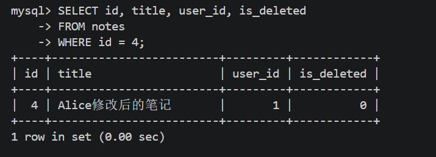
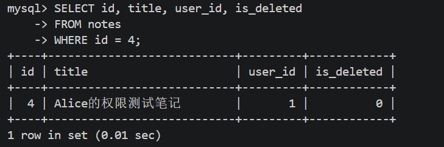

# 任务 02：用户注册、登录与笔记权限控制

## 一、任务目标

本任务在 JotangNote 笔记平台中实现用户注册、用户登录和笔记所有权校验，主要目标如下：

1. 用户可以注册账号。
2. 用户登录时，系统验证用户名和密码。
3. 用户密码经过 BCrypt 哈希处理后再保存到数据库，而不是直接保存明文密码。
4. 用户登录成功后，服务器使用 HTTP Session 保存当前用户的身份信息。
5. 创建笔记时，服务器自动将当前登录用户设置为笔记所有者。
6. 用户只能修改或删除自己发布的笔记，不能修改或删除其他用户的笔记。

## 二、数据库设计

### 2.1 用户表 `users`

用户表用于保存注册信息，主要字段如下：

| 字段 | 类型 | 作用 |
|---|---|---|
| `id` | `BIGINT` | 用户唯一标识，自动增长 |
| `username` | `VARCHAR(50)` | 用户名，不能重复 |
| `password` | `VARCHAR(255)` | 保存经过 BCrypt 哈希处理的密码 |
| `created_at` | `DATETIME` | 用户注册时间 |

`username` 设置了唯一约束，避免重复注册相同用户名。

### 2.2 笔记表 `notes`

在原有笔记表的基础上增加 `user_id` 字段，用于记录每篇笔记的所有者。

```sql
ALTER TABLE notes
ADD COLUMN user_id BIGINT NULL COMMENT '笔记发布者用户ID';
```

`user_id` 用来关联笔记发布者的用户 ID。本任务通过它判断用户是否有权修改或删除某篇笔记。

由于数据库中可能存在旧笔记，因此该字段暂时允许为 `NULL`。

## 三、核心代码逻辑

### 3.1 用户注册

涉及文件：

- `entity/User.java`
- `mapper/UserMapper.java`
- `service/UserService.java`
- `controller/UserController.java`

注册流程：

1. 客户端提交用户名和密码。
2. 控制器检查用户名和密码是否为空。
3. 服务层查询数据库，检查用户名是否已经存在。
4. 使用 `BCryptPasswordEncoder` 对密码进行哈希处理。
5. Mapper 将用户名和处理后的密码写入 `users` 表。
6. 控制器返回注册结果。

核心代码：

```java
user.setPassword(passwordEncoder.encode(user.getPassword()));
return userMapper.insert(user) > 0;
```

第一行将用户输入的密码替换为 BCrypt 处理后的结果；第二行调用 Mapper 插入用户记录，并根据受影响的行数判断注册是否成功。

### 3.2 用户登录

用户提交用户名和密码后，服务层首先查询用户记录，再使用 BCrypt 验证输入的密码是否匹配数据库中保存的哈希值。

```java
if (!passwordEncoder.matches(rawPassword, user.getPassword())) {
    return null;
}
```

如果用户名不存在或密码不匹配，登录失败；验证通过后，控制器将用户 ID 存入 Session：

```java
session.setAttribute("userId", loggedInUser.getId());
```

后续请求携带有效的 Session Cookie 时，服务器就可以根据 Session 中的 `userId` 识别当前用户。

### 3.3 创建笔记时确定所有者

创建笔记前，控制器先从 Session 获取当前用户 ID，再设置到笔记对象中：

```java
Long userId = getCurrentUserId(session);
note.setUserId(userId);
```

随后调用服务层保存笔记。Mapper 将 `user_id` 一并写入数据库。

这样，笔记所有者由服务器根据登录状态决定，而不是直接相信客户端提交的 `userId`。

### 3.4 修改和删除笔记时验证所有权

修改和删除操作都要求用户已登录，并且 SQL 同时检查笔记 ID、用户 ID 和删除状态。

删除操作的核心条件：

```sql
WHERE id = #{id}
  AND user_id = #{userId}
  AND is_deleted = 0
```

修改操作采用相同的所有权校验思路。

只有当笔记存在、尚未删除，并且当前用户是笔记所有者时，数据库操作才会成功。如果没有记录符合条件，操作就不会修改或删除该笔记。

本任务中，查询接口 `GET /notes/{id}` 仍然保持公开；重点限制的是创建、修改和删除操作中的登录状态与所有权。

## 四、接口与测试记录

### 4.1 用户注册

接口：`POST /users/register`

请求示例：

```json
{
  "username": "alice",
  "password": "实际注册密码"
}
```

测试内容：

- 使用新用户名注册。
- 重复使用同一用户名注册。
- 检查数据库中的密码是否为哈希后的字符串，而不是明文密码。

预期结果：新用户注册成功，重复用户名不能注册。



### 4.2 用户登录

接口：`POST /users/login`

请求示例：

```json
{
  "username": "alice",
  "password": "实际注册密码"
}
```

测试内容：

- 使用正确的用户名和密码登录。
- 检查响应是否显示登录成功。
- 检查响应是否返回 Session Cookie。
- 后续请求携带 Cookie，验证登录会话是否有效。

预期结果：正确的账号密码可以登录，错误的账号密码不能通过验证。



### 4.3 未登录用户创建笔记

接口：`POST /notes`

测试方法：不携带有效登录 Cookie，尝试创建笔记。

测试结果：服务器返回 HTTP `401 Unauthorized`，拒绝未登录用户创建笔记。



### 4.4 Alice 创建自己的笔记

测试方法：Alice 登录后创建一篇测试笔记，再查询数据库。

测试结果：笔记创建成功，数据库中对应记录的 `user_id` 为 Alice 的用户 ID。本次测试记录中，笔记 ID 为 `4`，用户 ID 为 `1`。



### 4.5 Bob 尝试修改 Alice 的笔记

测试方法：使用 Bob 的登录 Cookie 请求修改 `/notes/4`。

测试结果：服务器拒绝 Bob 的修改请求，提示笔记不存在、已删除或无权修改。



### 4.6 Bob 尝试删除 Alice 的笔记

测试方法：使用 Bob 的登录 Cookie 请求删除 `/notes/4`。

测试结果：在确认 Bob 的登录会话有效后，服务器拒绝删除操作，笔记仍然保留。



### 4.7 Alice 修改自己的笔记

测试方法：使用 Alice 的有效登录 Cookie 修改 `/notes/4`，将标题改为“Alice修改后的笔记”。

测试结果：服务器返回修改成功。数据库记录显示标题已经更新，`user_id` 仍为 `1`，`is_deleted` 仍为 `0`。



### 4.8 数据库验证

使用以下 SQL 查询笔记记录：

```sql
SELECT id, title, user_id, is_deleted
FROM notes
WHERE id = 4;
```

通过查询确认：

- 笔记的所有者仍为 Alice。
- Bob 的越权修改和删除操作没有改变笔记。
- Alice 可以修改自己的笔记。
- 笔记仍处于未删除状态。



## 五、测试总结

本任务完成了用户注册、登录和笔记所有权控制的基本实现。

通过 Session 保存登录用户的 ID，并在创建、修改和删除笔记时从服务器端获取当前用户身份，可以避免仅依赖客户端提供的用户 ID 进行权限判断。

通过在 SQL 中增加 `user_id` 条件，系统可以拒绝其他用户对笔记的修改和删除请求，同时允许笔记所有者正常操作自己的笔记。
