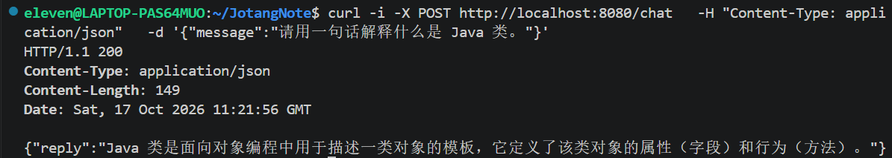

# 进阶篇 Part 1：接入 MiMo API，实现 AI 对话

## 一、任务目标

本阶段为 JotangNote 接入 MiMo 大模型 API。用户向后端发送一条消息后，后端将消息发送给模型，接收模型生成的回复，再将回复返回给用户。

本阶段的重点是理解后端服务如何调用外部 AI API，而不是训练模型或在本地部署模型。

## 二、功能流程

1. 用户向后端的 `/chat` 接口发送消息。
2. `ChatController` 接收请求并读取消息内容。
3. 控制器调用 `AiChatService`。
4. `AiChatService` 根据配置的 API 地址、模型和 API Key 组织请求。
5. 后端向 MiMo API 发送请求并读取响应。
6. 后端提取模型回复，返回给用户。

```text
用户
  │ 发送消息
  ▼
POST /chat
  │
  ▼
ChatController
  │ 调用服务
  ▼
AiChatService
  │ HTTP 请求
  ▼
MiMo API
  │ 模型回复
  ▼
AiChatService → ChatController → 用户
```

## 三、核心代码位置

- `Project/SpringBootHello/src/main/java/com/jotangnote/controller/ChatController.java`
- `Project/SpringBootHello/src/main/java/com/jotangnote/ai/AiChatService.java`
- `Project/SpringBootHello/src/main/resources/application.properties`

## 四、核心代码逻辑

### 4.1 ChatController：接收请求

`ChatController` 是 HTTP 请求进入 AI 功能的入口。它负责接收前端或命令行发送的消息，调用 AI 服务，并将结果返回给调用方。

将接口处理逻辑与模型调用逻辑分开，可以让代码的职责更清晰。

### 4.2 AiChatService：调用 MiMo API

`AiChatService` 负责组织模型请求、发送请求、读取响应并提取回复内容。

由于模型服务属于外部依赖，调用可能因网络问题、密钥配置错误、请求格式错误或服务端异常而失败，因此需要考虑异常处理。

### 4.3 配置文件

`application.properties` 用于保存 API 地址、模型名称等配置。API Key 应通过环境变量等安全方式提供，例如使用 `MIMO_API_KEY`，不要将真实密钥写入文档或提交到 Git 仓库。

## 五、测试步骤与结果

| 编号 | 测试内容 | 操作 | 实际结果 |
|---|---|---|---|
| 1 | 正常对话 | 发送“你好，请简单介绍一下自己” | 待填写 |
| 2 | 不同问题 | 发送另一条问题，检查回复是否与问题相关 | 待填写 |
| 3 | 服务异常 | 在安全可控的测试环境中检查 API 不可用时的错误处理 | 待填写 |
| 4 | 密钥配置 | 确认使用环境变量读取密钥，文档和 Git 中不包含真实密钥 | 待填写 |

## 六、测试截图

  

## 七、本阶段总结

本阶段完成了从 HTTP 接口到外部大模型服务的基本调用链路。需要理解的关键点是：Controller 接收请求，Service 负责调用 MiMo API，模型响应经过后端处理后返回给用户。