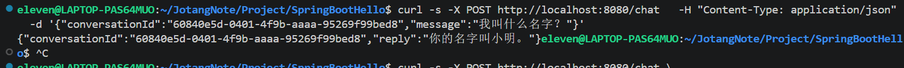

# 进阶篇 Part 2：为 AI 对话加入多轮对话历史

## 一、任务目标

在 Part 1 单轮对话的基础上，让 AI 能够结合同一会话中之前的消息理解后续问题，而不是每次都把用户的新消息当作完全独立的问题处理。

本阶段的核心是维护对话上下文，并通过 `conversationId` 区分不同会话。

## 二、功能流程

1. 用户发送第一条消息。
2. 后端为新会话生成一个 `conversationId`。
3. 后端保存该会话的消息历史。
4. 后端将相关历史与新消息一起交给 AI 服务。
5. 模型生成回复后，后端把用户消息和模型回复继续加入历史。
6. 后续请求携带相同的 `conversationId`，后端据此取回历史并继续对话。

```text
第一条消息
    │
    ▼
创建 conversationId
    │
    ▼
读取或建立会话历史
    │
    ▼
将历史与新消息交给模型
    │
    ▼
得到回复并更新历史
    │
    ▼
后续请求携带同一 conversationId
```

## 三、核心代码位置

- `Project/SpringBootHello/src/main/java/com/jotangnote/controller/ChatController.java`
- `Project/SpringBootHello/src/main/java/com/jotangnote/ai/AiChatService.java`

## 四、核心代码逻辑

### 4.1 conversationId 的作用

`conversationId` 是一段对话的标识。

第一次发起对话时，后端创建标识并返回；继续聊天时，客户端把这个标识再次传给后端。后端就能找到对应的历史消息。

如果每次请求都创建新的会话，后端便无法把新问题与之前的对话关联起来。

### 4.2 保存对话历史

历史通常需要保留用户消息和 AI 回复，并按照发生顺序传递给模型。具体消息字段与请求结构应以项目代码为准。

项目此前的分析记录显示，会话历史曾使用内存中的 `ConcurrentHashMap` 保存。这种方式实现简单，适合学习和单实例原型，但应用重启后历史会丢失，也不能自然地在多个后端实例之间共享。

### 4.3 多轮对话与长期记忆的区别

多轮对话历史意味着后端把此前的消息再次提供给模型。它不代表模型永久记住了用户，也不意味着模型可以自动访问数据库中的全部笔记。

## 五、测试步骤与结果

| 编号 | 测试内容 | 操作 | 实际结果 |
|---|---|---|---|
| 1 | 创建会话 | 发送第一条消息，检查响应中是否有 `conversationId` | 待填写 |
| 2 | 延续会话 | 使用返回的 `conversationId` 发送追问，检查 AI 是否结合上一轮内容回答 | 待填写 |
| 3 | 新会话隔离 | 不传旧 `conversationId` 或创建新会话，检查是否与旧会话分开 | 待填写 |
| 4 | 异常处理 | 检查模型请求失败时接口如何响应 | 待填写 |

测试多轮对话时，应使用同一会话 ID 进行追问；否则不能验证历史是否被正确复用。

## 六、测试截图

  

## 七、注意事项

- 如果会话历史只保存在 JVM 内存中，后端重启会导致历史丢失。
- 会话历史需要限制长度或设置过期策略，避免无限增长。
- 如果会话 ID 没有与登录用户绑定，不能仅凭会话 ID 作为访问私人数据的授权依据。
- 不要在文档或截图中暴露 API Key、Cookie 或其他敏感凭据。

## 八、本阶段总结

本阶段让 AI 对话具备了上下文连续性。关键是使用会话 ID 定位历史消息，并将历史与新消息一起提交给模型。
