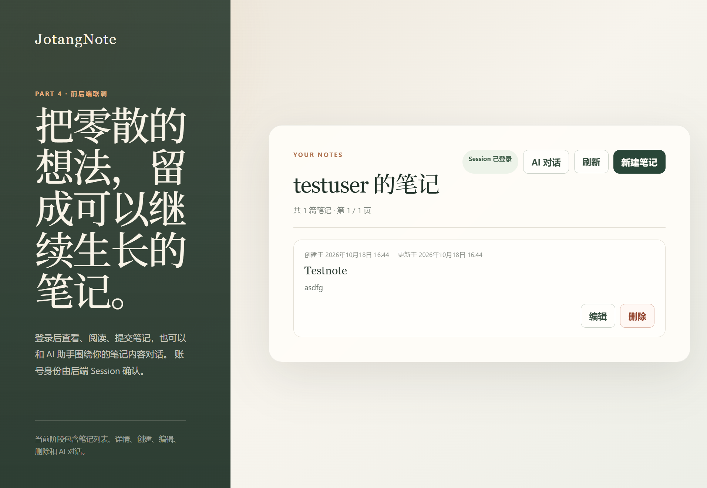
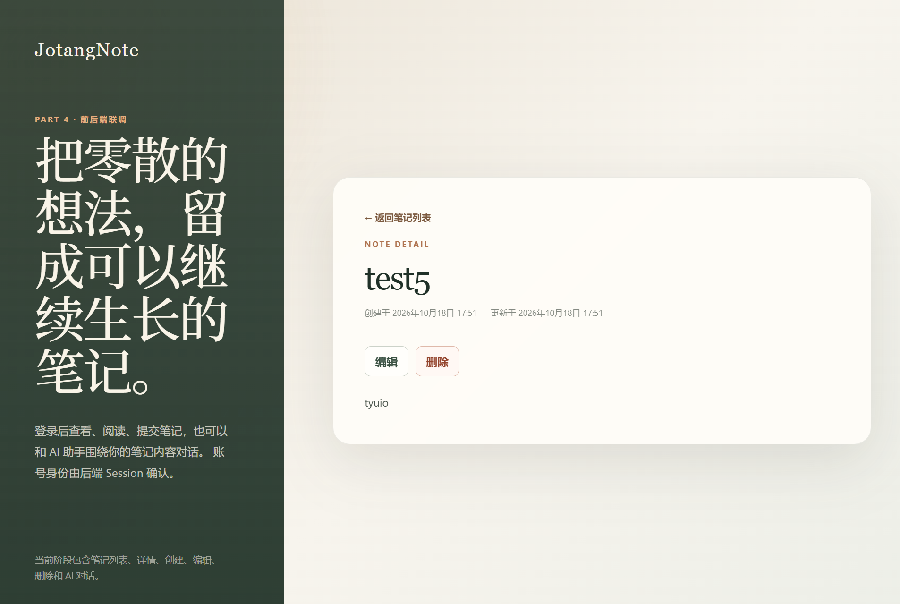
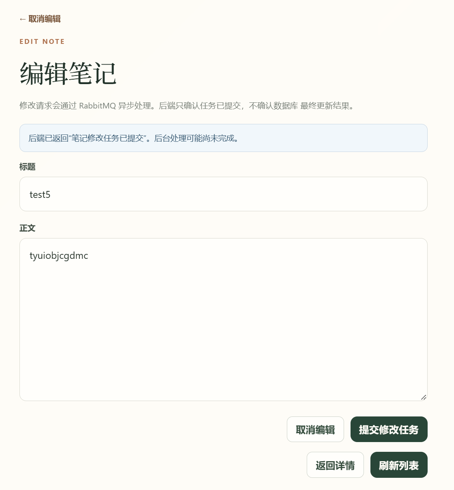
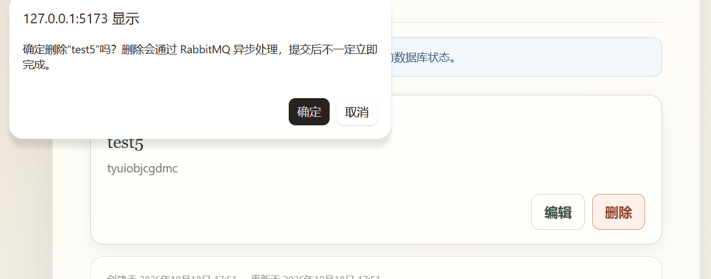
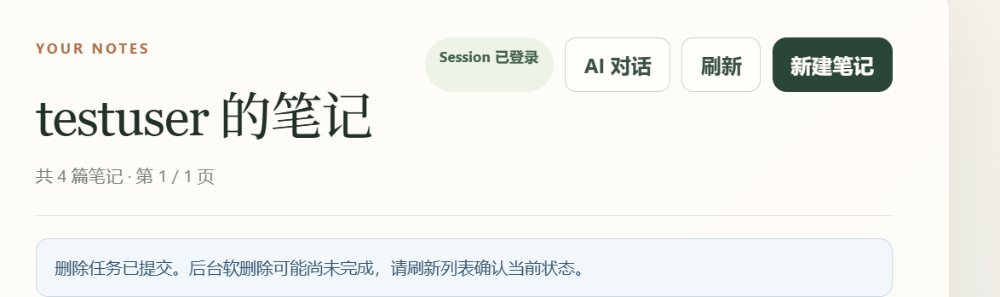
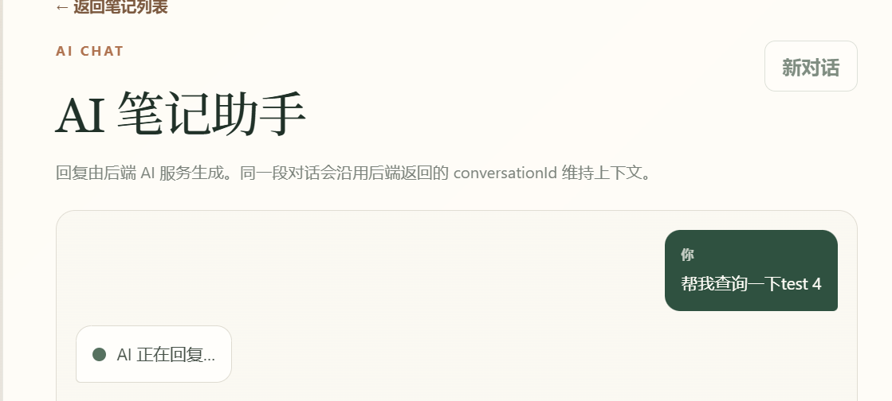

# Part 4：JotangNote 前后端联调与 AI 聊天实践
> 技术栈：Vue 3、Vite、Spring Boot、MyBatis、MySQL、Redis、RabbitMQ、MiMo AI  
> 阅读提示：遇到不熟悉的词时，可以先把它理解成“浏览器、Java 程序、数据库之间怎样传话”。

---

## 一、实验目标

Part 1 到 Part 3 主要完成了后端接口、用户权限、Redis 缓存和 RabbitMQ 异步处理。Part 4 的重点是把这些后端能力接到 Vue 前端，形成一个可以实际操作的主线流程：

1. 注册和登录。
2. 查询当前登录用户。
3. 分页查看自己的笔记。
4. 查看笔记详情。
5. 提交新建笔记任务。
6. 提交修改笔记任务。
7. 提交删除笔记任务。
8. 使用 AI 聊天界面调用后端 `/chat`。
9. 通过 Vite 开发代理完成前后端联调。

本阶段最重要的学习点不是“页面看起来更完整”，而是理解下面这条链路：

```text
浏览器中的 Vue 页面
    ↓ HTTP 请求
Vite 开发服务器（/api 代理）
    ↓ 去掉 /api 后转发
Spring Boot Controller
    ↓
Service → Mapper → MySQL
    ↓
RabbitMQ / Redis / MiMo AI
```

同时必须区分两件不同的事情：

- **任务已提交**：后端已经把消息交给 RabbitMQ，但消费者可能还没执行完。
- **数据库操作最终成功**：消费者已经执行完 SQL，并且数据确实发生了变化。

---

## 二、已完成功能

| 功能 | 前端地址或操作 | 后端接口 | 当前实际返回 |
| --- | --- | --- | --- |
| 用户注册 | 登录页“注册” | `POST /users/register` | 纯文本 |
| 用户登录 | 登录页“登录” | `POST /users/login` | 纯文本，并建立 Session |
| 当前用户 | 前端可调用 | `GET /users/me` | JSON |
| 笔记列表 | 登录后的首页 | `GET /notes?page=1&size=10` | JSON |
| 笔记详情 | 点击列表笔记 | `GET /notes/{id}` | JSON 或空响应 |
| 新建笔记 | “新建笔记” | `POST /notes` | 纯文本“笔记创建任务已提交” |
| 编辑笔记 | 列表或详情中的“编辑” | `PUT /notes/{id}` | 纯文本“笔记修改任务已提交” |
| 删除笔记 | 列表或详情中的“删除” | `DELETE /notes/{id}` | 纯文本“笔记删除任务已提交” |
| AI 聊天 | “AI 对话” | `POST /chat` | JSON |

说明：

- 浏览器实际请求的前端地址都带有 `/api` 前缀，例如 `/api/notes`。
- Vite 代理会把 `/api/notes` 改写成后端的 `/notes`。
- `/users/register`、`/users/login` 和笔记写接口返回的是纯文本，不是 JSON。

---

## 三、核心目录

```text
JotangNote/
├── frontend/                         # Vue 3 + Vite 前端
│   ├── vite.config.js                # 开发代理配置
│   └── src/
│       ├── App.vue                   # 当前页面的主要业务视图
│       ├── api.js                    # fetch 请求封装
│       └── style.css                 # 页面样式
├── Project/
│   ├── docs/                         # 实验文档与截图
│   └── SpringBootHello/              # Spring Boot 后端
│       └── src/main/java/com/jotangnote/
│           ├── controller/
│           ├── service/
│           ├── mapper/
│           ├── message/
│           ├── ai/
│           └── entity/
```

后端分层可以先用一句通俗的话理解：

- **Controller**：接收浏览器请求。
- **Service**：组织业务流程。
- **Mapper**：执行 SQL。
- **Entity**：表示数据库中的一行数据。
- **Message Producer / Consumer**：发送和接收 RabbitMQ 消息。

---

## 四、启动项目

### 4.1 启动前需要准备

根据当前后端配置，运行前需要本机具备：

- JDK 17。
- MySQL，并存在 `jotangnote` 数据库。
- Redis。
- RabbitMQ。
- 有效的 `MIMO_API_KEY` 环境变量。

### 4.2 启动后端

```bash
cd ~/JotangNote/Project/SpringBootHello
MIMO_API_KEY=你的密钥 ./mvnw spring-boot:run
```

启动后，默认后端地址为：

```text
http://127.0.0.1:8080
```

注意：修改 Java 后端代码或 `application.properties` 后，必须重新启动 Spring Boot，否则浏览器访问到的可能仍是旧进程。

### 4.3 启动前端

```bash
cd ~/JotangNote/frontend
npm install
npm run dev
```

正常会打开：

```text
http://localhost:5173
```

如果 5173 已被占用，Vite 会自动尝试 5174 等端口。以终端实际输出的地址为准。

### 4.4 构建前端

```bash
cd ~/JotangNote/frontend
npm run build
```

当前已记录构建成功。构建结果会写入 `frontend/dist/`。


---

## 五、Vite 代理和 Session Cookie

### 5.1 为什么需要代理

前端开发和后端开发通常运行在不同端口：

```text
前端：http://localhost:5173
后端：http://127.0.0.1:8080
```

如果浏览器直接从 5173 请求 8080，浏览器会把它们视为不同来源，可能触发跨域限制。Vite 代理的作用是让浏览器认为请求仍然发给前端服务器，再由 Vite 在后台转发给后端。

核心配置位于 [vite.config.js](../../frontend/vite.config.js)：

```js
server: {
  port: 5173,
  proxy: {
    '/api': {
      target: 'http://127.0.0.1:8080',
      changeOrigin: true,
      rewrite: (path) => path.replace(/^\/api/, ''),
    },
  },
}
```

关键语句解释：

- `'/api'`：所有以 `/api` 开头的请求交给代理。
- `target`：真正要访问的后端地址。
- `rewrite`：在转发前删掉路径开头的 `/api`。

例如：

```text
浏览器请求：/api/notes?page=1&size=10
后端收到：  /notes?page=1&size=10
```

### 5.2 Session Cookie 怎样工作

登录成功后，[UserController.java](../SpringBootHello/src/main/java/com/jotangnote/controller/UserController.java) 会执行：

```java
session.setAttribute("userId", loggedInUser.getId());
```

这句话的意思是：

> 在服务器保存的 Session 中放入一个键 `"userId"`，值是当前用户的 ID。

服务器响应登录请求时，会给浏览器一个 Cookie，名称通常是：

```text
JSESSIONID
```

浏览器下次请求时会带上这个 Cookie。后端根据 `JSESSIONID` 找到同一个 Session，再通过：

```java
session.getAttribute("userId")
```

判断当前是谁登录了。

前端统一请求封装位于 [api.js](../../frontend/src/api.js)：

```js
fetch(`${API_PREFIX}${path}`, {
  credentials: 'include',
  ...options,
})
```

`credentials: 'include'` 的作用是告诉浏览器：请求时也要携带 Cookie。

因为前端请求的是同源的 `/api/...`，所以 Cookie 先由浏览器发给 Vite，再由代理带到后端。这样不需要在前端保存用户名和密码。

---

## 六、用户注册与登录

### 6.1 用户注册

#### 实现目的

创建一个新用户，并把密码以 BCrypt 哈希形式保存到数据库，而不是保存明文密码。

#### 使用流程

1. 打开前端登录页。
2. 点击“注册”。
3. 输入用户名和密码。
4. 提交后调用 `POST /api/users/register`。

#### 核心代码位置

- [UserController.java](../SpringBootHello/src/main/java/com/jotangnote/controller/UserController.java)
- [UserService.java](../SpringBootHello/src/main/java/com/jotangnote/service/UserService.java)
- [UserMapper.java](../SpringBootHello/src/main/java/com/jotangnote/mapper/UserMapper.java)

#### 请求与响应

请求：

```http
POST /api/users/register
Content-Type: application/json
```

```json
{
  "username": "alice",
  "password": "你的密码"
}
```

可能的纯文本响应：

```text
注册成功
用户名已存在
用户名和密码不能为空
```

注意：当前业务失败也可能使用 HTTP 200，前端需要根据响应文本判断。

#### 关键逻辑

```java
user.setPassword(passwordEncoder.encode(user.getPassword()));
return userMapper.insert(user) > 0;
```

- `encode()` 把原始密码变成 BCrypt 哈希。
- `insert()` 返回受影响的行数。
- 大于 0 表示插入成功。

通俗理解：数据库保存的是一串经过处理的密码，即使有人看到数据库中的值，也不能直接得到用户输入的原始密码。

### 6.2 用户登录

#### 实现目的

验证用户名和密码，并在服务器 Session 中记录当前用户 ID。

#### 使用流程

1. 输入用户名和密码。
2. 前端调用 `POST /api/users/login`。
3. 登录成功后，浏览器获得 `JSESSIONID`。
4. 前端加载当前用户的笔记列表。

#### 请求与响应

```json
{
  "username": "alice",
  "password": "你的密码"
}
```

可能的响应：

```text
登录成功
用户名或密码错误
用户名和密码不能为空
```

#### 关键逻辑

```java
if (!passwordEncoder.matches(rawPassword, user.getPassword())) {
    return null;
}

session.setAttribute("userId", loggedInUser.getId());
```

- `matches()` 比较用户输入密码和数据库中的哈希是否对应。
- 比较失败返回 `null`。
- 成功后服务器记住 `"userId"`。



### 6.3 获取当前登录用户

#### 实现目的

让前端只依赖 Session 判断当前用户，而不是相信前端自己传过来的用户 ID。

#### 使用流程

```text
GET /api/users/me
```

成功后响应：

```json
{
  "id": 1,
  "username": "alice"
}
```

未登录：

```http
HTTP/1.1 401 Unauthorized
```

```json
{
  "message": "未登录"
}
```

#### 关键逻辑

```java
Object userId = session.getAttribute("userId");

if (!(userId instanceof Long id)) {
    return ResponseEntity
            .status(HttpStatus.UNAUTHORIZED)
            .body(new ErrorResponse("未登录"));
}
```

- 不信任浏览器直接提交的用户 ID。
- 只读取服务器 Session 里的 `"userId"`。
- 响应使用 `CurrentUserResponse(id, username)`，不包含密码。

---

## 七、笔记列表与详情

### 7.1 查询当前用户笔记列表

#### 实现目的

只展示当前登录用户尚未删除的笔记，并支持分页。

#### 使用流程

```text
GET /api/notes?page=1&size=10
```

后端实际地址：

```text
GET /notes?page=1&size=10
```

#### 分页规则

- `page` 默认是 1。
- `size` 默认是 10。
- `page < 1` 时按 1 处理。
- `size < 1` 时按 10 处理。
- `size` 最大是 100。

#### 响应结构

```json
{
  "notes": [
    {
      "id": 11,
      "title": "第一篇笔记",
      "content": "正文内容",
      "createdAt": "2026-10-18T16:00:00",
      "updatedAt": "2026-10-18T16:10:00"
    }
  ],
  "page": 1,
  "size": 10,
  "total": 1,
  "totalPages": 1
}
```

#### 核心代码位置

- [NoteController.java](../SpringBootHello/src/main/java/com/jotangnote/controller/NoteController.java)
- [NoteService.java](../SpringBootHello/src/main/java/com/jotangnote/service/NoteService.java)
- [NoteMapper.java](../SpringBootHello/src/main/java/com/jotangnote/mapper/NoteMapper.java)
- [App.vue](../../frontend/src/App.vue)

#### 关键逻辑

```java
Long userId = getCurrentUserId(session);
```

用户 ID 来自 Session，而不是查询参数。

SQL 条件：

```sql
WHERE user_id = #{userId}
  AND is_deleted = 0
ORDER BY created_at DESC, id DESC
LIMIT #{size} OFFSET #{offset}
```

- `user_id` 保证只查询当前用户的笔记。
- `is_deleted = 0` 排除已逻辑删除的笔记。
- `LIMIT` 和 `OFFSET` 实现分页。
- 按创建时间和 ID 倒序，通常新笔记排在前面。

通俗理解：`page=2,size=10` 时，跳过前 10 条，再取 10 条。

前端会使用返回中的 `page`、`size`、`total`、`totalPages` 更新分页按钮状态。

### 7.2 查询笔记详情

#### 实现目的

展示一篇笔记的完整标题、正文和时间。

#### 使用流程

```text
GET /api/notes/{id}
```

例如：

```text
GET /api/notes/11
```

#### 核心逻辑

`NoteService#getNoteById` 当前会：

1. 先查询 Redis 键 `note:{id}`。
2. 缓存命中时反序列化为 `Note`。
3. 缓存未命中时查询 MySQL。
4. 找到数据后写回 Redis。

Mapper 当前使用的条件是：

```sql
WHERE id = #{id} AND is_deleted = 0
```

前端使用实际返回的 `id`、`title`、`content`、`createdAt`、`updatedAt` 展示详情。

注意：当前详情接口没有要求登录，也没有按 `user_id` 校验所有者。这是现有实现的风险，Part 4 没有擅自修改后端。



---

## 八、新建、编辑与删除笔记

这三个操作都通过 RabbitMQ 异步执行。前端看到的“任务已提交”不等于数据库已经处理完成。

### 8.1 为什么是异步

以新建为例：

```text
浏览器
  ↓ POST /notes
NoteController
  ↓ 从 Session 取得 userId
NoteMessageProducer
  ↓ convertAndSend
RabbitMQ
  ↓
NoteMessageConsumer
  ↓ CREATE
NoteService
  ↓
NoteMapper / MySQL
```

Controller 把消息发送出去后立即返回。真正执行 INSERT 的是后台消费者。

当前接口没有：

- 任务 ID。
- 任务状态查询接口。
- 新笔记 ID 返回值。
- 消费成功或失败的回执。

因此前端只能展示“任务已提交”，不能展示“数据库写入成功”。

### 8.2 新建笔记

#### 实现目的

从页面提交标题和正文，创建一个异步新增任务。

#### 使用流程

```text
POST /api/notes
Content-Type: application/json
```

```json
{
  "title": "新笔记标题",
  "content": "新笔记正文"
}
```

后端精确返回：

```text
笔记创建任务已提交
```

#### 核心代码位置

- [NoteController.java](../SpringBootHello/src/main/java/com/jotangnote/controller/NoteController.java)
- [NoteMessageProducer.java](../SpringBootHello/src/main/java/com/jotangnote/message/NoteMessageProducer.java)
- [NoteMessageConsumer.java](../SpringBootHello/src/main/java/com/jotangnote/message/NoteMessageConsumer.java)

#### 关键逻辑

```java
Long userId = getCurrentUserId(session);
note.setUserId(userId);

message.setAction("CREATE");
message.setNote(note);
message.setUserId(userId);
noteMessageProducer.send(message);
```

- `userId` 来自 Session，防止前端伪造所有者。
- 消息动作是 `"CREATE"`。
- Producer 把消息发送到 RabbitMQ。

#### 前端处理

前端只在后端精确返回：

```text
笔记创建任务已提交
```

时显示“任务已提交”。随后立即重新请求列表，但列表刷新只表示查看当前数据库状态，不能证明新建任务一定已经完成。

### 8.3 编辑笔记

#### 实现目的

修改已有笔记的标题和正文。

#### 使用流程

从列表或详情点击“编辑”，表单预填当前标题和正文：

```text
PUT /api/notes/{id}
Content-Type: application/json
```

```json
{
  "title": "修改后的标题",
  "content": "修改后的正文"
}
```

后端精确返回：

```text
笔记修改任务已提交
```

#### 关键逻辑

Controller 会使用 URL 中的 ID 和 Session 中的用户 ID：

```java
note.setId(id);
note.setUserId(userId);
```

更新 SQL：

```sql
WHERE id = #{id}
  AND user_id = #{userId}
  AND is_deleted = 0
```

- 只有笔记所有者才能修改成功。
- 已删除笔记不能被修改。
- 如果 SQL 影响行数为 0，当前消费者仍可能正常结束，HTTP 发起方无法获得最终失败原因。

前端显示“修改任务已提交”，不会显示“修改成功”。




### 8.4 删除笔记

#### 实现目的

提交逻辑删除任务，把 `is_deleted` 改为 1，而不是直接删除数据库记录。

#### 使用流程

1. 在列表或详情点击“删除”。
2. 浏览器确认框询问是否确认。
3. 确认后调用：

```text
DELETE /api/notes/{id}
```

后端精确返回：

```text
笔记删除任务已提交
```

#### 关键逻辑

删除 SQL：

```sql
UPDATE notes
SET is_deleted = 1
WHERE id = #{id}
  AND user_id = #{userId}
  AND is_deleted = 0
```

- 这里执行的是软删除。
- 数据行仍然留在数据库中，只是正常查询会过滤它。
- 所有者条件防止删除其他用户的笔记。

前端在确认框中明确提示这是异步操作。任务提交后不会立即把笔记从页面永久移除，而是让用户刷新列表查看数据库当前状态。





---

## 九、AI 聊天界面

### 9.1 实现目的

在登录后的页面中增加 AI 对话区域，调用现有后端 `/chat`，展示用户消息、加载状态和真实 AI 回复。

### 9.2 前端请求

前端请求：

```text
POST /api/chat
Content-Type: application/json
```

首次对话：

```json
{
  "message": "帮我总结最近一篇笔记"
}
```

后端返回 `conversationId` 后，后续消息：

```json
{
  "message": "再简短一点",
  "conversationId": "后端返回的 UUID"
}
```

后端成功响应：

```json
{
  "conversationId": "xxxxxxxx-xxxx-xxxx-xxxx-xxxxxxxxxxxx",
  "reply": "真实 AI 回复"
}
```

### 9.3 前端状态

核心代码位置：

- [App.vue](../../frontend/src/App.vue)
- [api.js](../../frontend/src/api.js)

前端行为：

1. 用户发送非空消息后，立即显示用户自己的消息。
2. 请求期间显示“AI 正在回复…”。
3. 只有收到非空 `reply` 后，才追加 AI 消息。
4. 保存返回的 `conversationId`，下一次请求继续携带。
5. 点击“新对话”会清空前端消息和 `conversationId`。
6. 空消息、网络错误、HTTP 错误和异常响应都有中文提示。

通俗理解：页面的“AI 正在回复”只是加载状态，不是 AI 已经回答；真正的回答必须来自后端返回的 `reply`。

### 9.4 后端处理流程

[ChatController.java](../SpringBootHello/src/main/java/com/jotangnote/controller/ChatController.java)：

1. 读取 `message` 和可选 `conversationId`。
2. `message` 为空时返回 HTTP 400。
3. 没有 `conversationId` 时生成 UUID。
4. 从内存 `ConcurrentHashMap` 取出或创建对话历史。
5. 把用户消息加入历史。
6. 调用 `AiChatService#chatWithNoteTool`。
7. 成功后返回 `conversationId` 和 `reply`。
8. AI 调用异常时返回 HTTP 502。

[AiChatService.java](../SpringBootHello/src/main/java/com/jotangnote/ai/AiChatService.java) 向 MiMo 声明了工具：

```text
get_note_by_id
```

模型请求该工具时，后端会调用：

```java
Note note = noteService.getNoteById(noteId);
```

然后把笔记标题和正文作为工具结果交回模型，最终生成回复。

### 9.5 错误和加载状态

| 情况 | 前端表现 |
| --- | --- |
| 输入为空 | 提示“请输入聊天内容” |
| 正在等待回复 | 禁用发送按钮，显示“AI 正在回复…” |
| 网络不可用 | 提示发送失败 |
| HTTP 502 | 提示“AI 服务暂时不可用” |
| 返回内容缺少有效 `reply` | 提示回复格式错误，不生成假回复 |
| 登录失效 | 进入重新登录状态 |



---

## 十、总结

Part 4 完成的主要工作是把已有后端能力接入 Vue 前端，并建立统一的请求封装和开发代理。

需要特别记住：

1. 前端不要相信客户端传入的 `userId`，身份应来自 Session。
2. 登录成功后，浏览器通过 `JSESSIONID` 找回服务器 Session。
3. Vite 的 `/api` 代理负责把开发环境请求转发给 Spring Boot。
4. 笔记写操作是异步的，“任务已提交”不等于“数据库最终成功”。
5. AI 回复必须来自后端真实响应，不能由前端生成占位回复。
6. 当前详情查询和 AI 笔记工具仍存在权限风险，需要后续单独完善。
